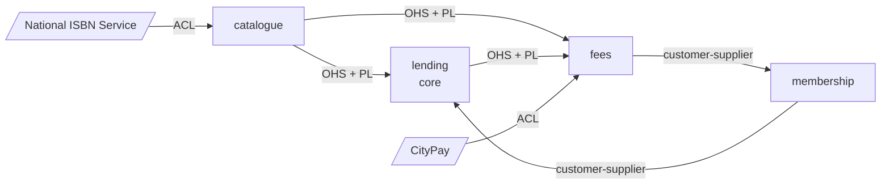

# Chapter 3 — Strategic design

**Input:** [the brief](../requirements/brief.md), [chapter 1](01-big-picture.md), [chapter 2](02-domain-stories.md)
**Tool:** DDD Studio, the Big Picture board and the context map
**Result:** four bounded contexts, a context map, a glossary per context, a [clarification log](../requirements/clarifications.md), and the model in [`model/esdm/`](../model/esdm/).

## Where we stand

After two chapters we know a lot about *what happens*. We do not yet know *where one model ends and the next begins*. That is the question of this chapter, and it comes in three parts:

1. Which questions must the business answer before we can cut?
2. Where do the boundaries run, and why there?
3. How do the resulting contexts relate to each other and to the systems around them?

## Step 1: Ask first, then cut

Chapters 1 and 2 left questions open. Five events on the board had no cause (*Reservation Cancelled*, *Usage Fee Charged*, *Lost-Book Fee Charged*, *Researcher Status Expired*, *Card Expired*), and three business questions had piled up. They matter for the cut: whoever blocks a card decides whether membership has to know about fine amounts, and the way a payment reaches CityPay decides where the boundary to CityPay runs.

In a real project we would call the people in the brief. Here the maintainer plays the library's side and answers on request. So that nobody mistakes such an answer for something the brief said, each question goes into a **clarification log**, [`requirements/clarifications.md`](../requirements/clarifications.md). Each entry names the source in the brief, why it matters now, the options, a recommendation, and later the decision with date and person. The brief itself stays untouched. Everything that builds on an answer cites its number (`C-03`, …).

Two entries show why the log is worth keeping.

- **C-03, when is a late fine assessed?** Our first proposal was: once, when the book comes back or is lost. The maintainer rejected it. A reader who never returns a book would then never be blocked, which defeats the purpose of fines ("Fines … exist so that books come back"). The decision: the fine is *assessed* on return (or on loss, see C-04), but while the book is out a *running* amount counts towards the €10 block. The rejected proposal and the reason stay in the log.
- **C-07, which words do we use?** *Title* and *copy* instead of "book", *item* and *instance*; *reader* in lending and fees, *member* in membership; *patron* is dropped. The words that lose are recorded in the glossary, so someone who searches for them still finds the right one.

The decisions C-01 to C-10, C-17 and C-18 are applied on the Big Picture board (tag `clar:C-nn` on the cards they changed). Five events got a cause, four policies were added, and the €10 policy now checks every morning. The hotspots that were answered carry `clar:`, the ones deliberately postponed carry `parked:` (C-11 to C-15; C-16 has no card yet). All of these are to be decided when the model needs them. Both policies, block and unblock, are drawn in the `fees` area. The amounts are known there, and they end in an event of membership, which is the arrow from fees to membership on the map. One consequence to watch: the connections from the Membership Officer to *Card Blocked* and *Card Unblocked* still show how it is done today, by hand. The new policies show how it should be done. We keep both on purpose.

## Step 2: Find the seams

A boundary is worth drawing where the **language** changes, where **different people decide**, or where things change at a **different pace**. The board shows four such places.

| Seam | What we see on the board | Who decides |
|---|---|---|
| Catalogue | *title* (ISBN, author, price) and *copy* (own barcode, circulating or restricted). Head of Collection: "What happens to a book after it leaves my desk is the branches' business, honestly." | Collection |
| Lending | reserve, borrow, return, overdue, the morning lists; here "copy" means *what may be done with it right now* | Branch Librarian |
| Membership | card, researcher status, block; here the person is a *member* | Membership Officer |
| Fees | late fine, lost-book fee, usage fee, payment, the monthly report; a waiver appears there too, who may grant one is open (C-16) | City finance (Treasury Liaison) |

The word **book** is the clearest signal. The Head of Collection means the catalogue entry, the desk means the thing on the shelf. The two language hotspots of the board are about exactly these words. The same word with two meanings is what a boundary is for.

Some cards sit on a seam, and the board makes it visible once the contexts are drawn as areas. *Book Declared Lost* belongs to lending, but fees reacts to it. *Card Blocked* is an event of membership, yet the rule that triggers it needs the amounts from fees. A card can only sit in one area; where the arrow crosses the frame, a mapping will be needed.

### What we did not cut

- **A context for notifications.** The reminders (reservation ready, reservation about to expire, due soon) are wishes from the survey, they all concern lending, and they leave the system through the city's mail gateway. We cannot name a vocabulary of its own for them and they have no aggregate. A context without its own language costs a mapping and a translation for nothing. If a second channel or user preferences arrive, this decision is worth revisiting.
- **The reader's account page** (what they have at home, what is waiting for them, what they owe). It reads from lending and fees. That is a *view* across contexts, not a context. Where it lives is a question for the modelling of the individual contexts.
- **Blocking inside lending.** Whether a card is blocked is a decision of the membership office. Lending only uses what membership publishes.

## Step 3: The cut

| Context | Subdomain | Type | Team |
|---|---|---|---|
| `catalogue` | collection | supporting | Collection |
| `lending` | circulation | **core** | Circulation |
| `membership` | member-services | supporting | Members |
| `fees` | fines-and-payments | supporting | Finance |

**Why only lending is core.** The director wants one system for all branches, fewer phone calls, readers who can see their own account, and good treatment of researchers. Most of that happens in lending. The other three have to be right but do not set the library apart from any other. If we marked all four as core, the classification would tell us nothing.

**About the teams.** The brief knows one small development team and "One application to run, please, not a zoo of services.". The four teams are an assumption of this tutorial: we model as if each context had its own team, because that makes the contracts between the contexts visible. They are tags on the contexts, nothing more.

## Step 4: The context map

*Arrows point from upstream to downstream. OHS = open host service, PL = published language, ACL = anti-corruption layer.*

| Upstream → downstream | Pattern | Why |
|---|---|---|
| ISBN service → catalogue | anti-corruption layer | Titles arrive oddly formatted and we cannot influence the service. The catalogue translates into its own title record; what remains is corrected by hand. *Conformist* would let the mess into the catalogue. |
| CityPay → fees | anti-corruption layer | Mandatory for the whole city, odd status codes, cents, 20-character references. None of this may reach the model of fees. |
| catalogue → lending, catalogue → fees | open host service + published language | Two consumers need the same thing: lending the copies and their flag, fees the price (lost-book fee, cap on late fines). One general service is cheaper than two bespoke ones. |
| membership → lending | customer-supplier | Lending says what it must know (card valid? blocked? researcher?). Membership decides and publishes every change; lending keeps the part it needs. Both sit in one organisation and can negotiate. |
| lending → fees | open host service + published language | Fees follows loans (due date, returned, lost, usage fee) without lending knowing that fees exist. Reminders and the reader account will need the same events, so lending publishes them once for everyone. Where the consumer's needs are negotiated one to one, as between membership and lending, *customer-supplier* fits better. |
| fees → membership | customer-supplier | The block follows from the amounts (C-01, C-03). Fees reports when the amount owed passes €10 or is back at €10 or less; membership decides what blocking means. The amount owed includes late fines, lost-book fees and usage fees (C-18). |

### Rejected

- **Partnership between catalogue and lending.** It appears if availability is placed in the catalogue: "can this copy be lent?" needs the lending state, and "is it a circulating copy?" needs the catalogue. Both contexts then have to react to each other and succeed or fail together. We avoid it by letting lending own *availability*; the catalogue only knows what a copy is.
- **Shared kernel.** Sharing a piece of model between teams that decide independently only ties them together. Nothing here is shared that a published event could not carry.
- **One context for fees and membership.** Both concern money and cards, but different people decide (treasury and membership office), and the words differ (*reader* against *member*).

## Step 5: One word, many meanings

The glossary lives on each context and is part of the export. The overlap is intended.

| Word | `catalogue` | `lending` | `membership` | `fees` |
|---|---|---|---|---|
| title | the catalogue entry | — | — | — |
| copy | a physical book with a barcode | a copy and what may be done with it now | — | — |
| person | — | *reader* | *member* | *reader* |
| researcher | — | a reader reported as a researcher | holder of *researcher status* | — |
| "block" | — | — | *blocked card* | — |
| money | *replacement price* | — | — | *late fine, lost-book fee, usage fee* |

**Words we reject:** *item* and *instance* (copy), *patron* (reader or member), *book* in the model (kept for everyday speech).

## What we found along the way

- **The contexts form a circle.** lending → fees → membership → lending. In chapter 3 we thought this harmless as long as every arrow is a published event. It is not: a module that reacts to an event has to know the event's type, so it depends on the module that publishes it, and three modules in a circle cannot be built or separated one by one. Chapter 4 follows this up (ADR-0004).
- **Damaged copies cross the seam in the other direction** (C-06). In the first release lending only marks the copy as damaged and lists it for the Head of Collection; repair and withdrawal happen outside the system (C-17). Handling them inside the system would make the relationship between lending and catalogue two-way, which we deliberately avoid for now.
- **The brief says "fines" for the block, but the amount owed is more than fines.** We count late fines, lost-book fees and usage fees (C-18). Otherwise a reader who lost a book could never be blocked.
- **The mail gateway has no mapping yet.** It is in the model as an external system. Which pattern fits depends on its interface, which the brief does not describe. Until we know it, we do not guess.
- **A bounded context without an aggregate is a placeholder.** That is expected here; the aggregates come with the modelling of each context.

## What we take into the next chapter

- How the four contexts are deployed is the topic of chapter 4. The brief already points to one application ("not a zoo of services"); chapter 4 turns that into a decision with reasons.
- Open before the specification work: the mail gateway and the parked C-11 to C-16.

---

*The boards live in the DDD Studio workspace "Millbrook Library (tutorial)". Saved versions: `ch3-before-clarifications`, `ch3-context-cut`, `ch3-context-cut-v2` and `ch3-context-cut-v3` (Big Picture with contexts as areas, snapshot in [`model/sketch/big-picture-contexts.json`](../model/sketch/big-picture-contexts.json)) and `ch3-context-map`, `ch3-context-map-v2` and `ch3-context-map-v3` (strategic model). The Big Picture of chapter 1 is kept as [`big-picture.json`](../model/sketch/big-picture.json). The reference project this tutorial adapts, [ddd-by-examples/library](https://github.com/ddd-by-examples/library), draws, according to its README and Big Picture notes, the same seam between catalogue and lending. Membership and fees go beyond it.*
